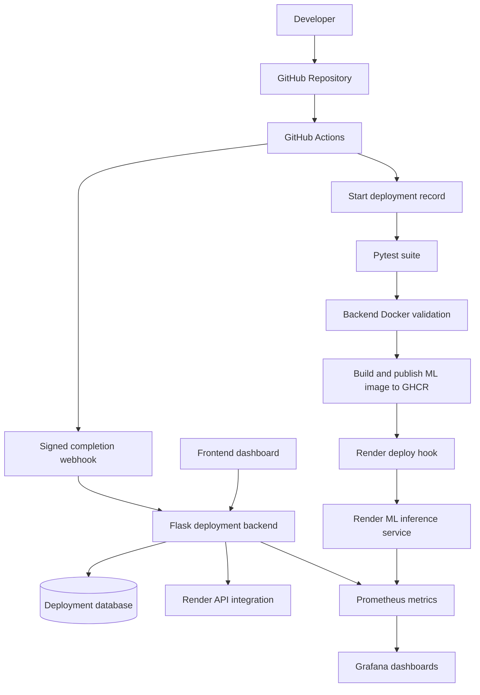

# Model-Setu

**CI/CD Deployment Pipeline for Machine Learning Applications**

Model-Setu is a deployment-engineering project that demonstrates how a machine-learning application can be tested, packaged, deployed, tracked, and monitored through an integrated CI/CD workflow.

The system combines a Flask-based ML inference API, a deployment-management backend, Docker, GitHub Actions, GitHub Container Registry (GHCR), Render, Prometheus, and Grafana.

> **Project scope:** Model-Setu focuses on the software delivery and operational lifecycle of an ML application. It does not add an AI-assisted analysis layer.

---

## Contents

- [Overview](#overview)
- [Architecture](#architecture)
- [Delivery workflow](#delivery-workflow)
- [Technology stack](#technology-stack)
- [Services and responsibilities](#services-and-responsibilities)
- [API reference](#api-reference)
- [Run locally](#run-locally)
- [Monitoring](#monitoring)
- [Deployment tracking and rollback](#deployment-tracking-and-rollback)
- [Repository layout](#repository-layout)
- [Verification and known limitations](#verification-and-known-limitations)
- [Security notes](#security-notes)
- [Future work](#future-work)

## Overview

Deploying an ML model is only one part of delivering an ML application. The surrounding service also needs repeatable tests, a consistent runtime package, a deployment process, operational visibility, and a way to understand which version is active.

Model-Setu brings these activities into one demonstrable workflow.

### Objectives

- Run automated tests when code is pushed or a pull request is opened.
- Build and publish a versioned ML-service container image.
- Trigger the configured Render deployment from the main-branch workflow.
- Record deployment versions, commit SHAs, workflow run IDs, and statuses.
- Expose deployment-management and rollback APIs.
- Export application and inference metrics for Prometheus.
- Visualize request, prediction, and deployment metrics in Grafana.

## Architecture

The detailed architecture diagram and component responsibilities are maintained in [`docs/architecture.md`](docs/architecture.md).



The frontend is a static HTML/CSS/JavaScript client that communicates with the backend API. The public frontend is hosted at https://model-setu.vercel.app. The Docker Compose configuration runs the backend, ML service, Prometheus, and Grafana locally.

## Delivery workflow

The GitHub Actions workflow is defined in `.github/workflows/ci.yml`.

1. A developer pushes a commit or opens a pull request against `main`.
2. GitHub Actions checks out the repository and installs the pinned Python dependencies.
3. For main-branch push and manual workflow runs, the workflow sends a signed start event to the backend and receives a deployment record ID.
4. Pytest runs the automated test suite.
5. Docker builds the backend image as a build validation step.
6. The ML-service image is built. For non-pull-request events, the workflow publishes the `latest` tag and the commit-SHA tag to GHCR.
7. For main-branch push and manual workflow runs, the workflow invokes the configured Render deploy hook.
8. The completion step reports the workflow result to the backend. On successful jobs, it polls while Render deployment tracking is pending.
9. The backend stores deployment state and exposes it through its API.
10. The checked-in Prometheus configuration defines scrape jobs for the local backend and ML service, plus production backend and ML endpoints. In the local Compose stack, Grafana reads the local Prometheus data source; Prometheus can additionally remote-write to Grafana Cloud when its token file is configured.

**Important distinction:** the workflow validates the backend Docker image but publishes the ML-service image to GHCR. The Render deploy hook is a separate deployment trigger. Do not interpret a successful image build alone as proof that every production endpoint or dashboard has been independently tested.

The workflow uses a concurrency group to serialize production deployment runs and reduce overlapping deployment-tracking ambiguity.

## Technology stack

| Area | Technology | Responsibility |
|---|---|---|
| Language | Python | Backend, ML API, automation |
| Backend | Flask | Deployment-management REST API |
| ML | scikit-learn | Iris classification model |
| Model persistence | joblib | Load the trained model artifact |
| Testing | pytest | Automated test suite |
| Containers | Docker, Docker Compose | Packaging and local orchestration |
| CI/CD | GitHub Actions | Test, build, publish, deploy trigger |
| Image registry | GitHub Container Registry | Store ML-service images |
| Cloud hosting | Render | Host backend and ML service |
| Database | SQLite / PostgreSQL | Persist deployment records |
| Metrics | Prometheus client, Prometheus | Instrumentation and scraping |
| Dashboards | Grafana | Metrics visualization |
| Frontend | HTML, CSS, JavaScript | Deployment dashboard interface |

## Services and responsibilities

### ML inference service

The ML service exposes a REST API for Iris flower classification using a scikit-learn Random Forest classifier. It validates the request payload, performs inference, and returns the predicted class and model metadata.

The model metadata endpoint reports the model's evaluation information. **Model accuracy and an individual prediction's confidence are different measures** and should not be conflated.

### Deployment-management backend

The Flask backend is responsible for:

- Creating and listing deployment records.
- Retrieving a deployment and the active deployment.
- Updating pending deployment status.
- Receiving HMAC-SHA256 signed CI/CD webhook events.
- Reading Render deployment information through the Render API.
- Initiating and tracking Render rollback operations.
- Exposing deployment and HTTP request metrics.
- Providing GitHub user, repository, branch, and workflow integration routes.

### Frontend dashboard

The `frontend/` directory contains the static dashboard client. It presents deployment and workflow information by calling the backend API. The repository contains the frontend source; a separate public frontend hosting deployment is not asserted here.

## API reference

The following tables describe the routes implemented in the repository. The hosted base URLs are:

- **ML service:** https://model-setu.onrender.com
- **Backend:** https://model-setu-backend.onrender.com

### ML service

| Method | Route | Purpose |
|---|---|---|
| GET | `/` | Service identity and status |
| GET | `/health` | Health and model-loaded status |
| GET | `/model-info` | Model metadata |
| GET | `/metrics` | Prometheus metrics |
| POST | `/predict` | Predict an Iris class |

Example request to `POST /predict`:

```json
{
  "features": [5.1, 3.5, 1.4, 0.2]
}
```

The `features` array must contain exactly four numeric values. A successful response contains the predicted class, class ID, confidence, model name, and model version.

Example response shape:

```json
{
  "prediction": "setosa",
  "class_id": 0,
  "confidence": 1.0,
  "model_name": "iris-random-forest",
  "model_version": "1.0.0"
}
```

The values above are an illustrative example for the supplied sample input, not a guarantee that every request returns the same prediction.

### Backend service

| Method | Route | Purpose |
|---|---|---|
| GET | `/` | Backend identity and status |
| GET | `/health` | Backend health check |
| GET | `/version` | Backend version |
| GET | `/deployments` | List deployment records |
| POST | `/deployments` | Create a deployment record |
| GET | `/deployments/{id}` | Retrieve one deployment |
| PATCH | `/deployments/{id}/status` | Complete a pending deployment |
| GET | `/active-deployment` | Retrieve the active deployment |
| POST | `/rollback/{deployment_id}` | Initiate a Render rollback |
| GET | `/rollback/status/{rollback_id}` | Check rollback operation status |
| GET | `/rollback-operations` | List rollback operations |
| GET | `/metrics` | Prometheus metrics |
| POST | `/webhook` | Receive signed CI/CD events |
| GET | `/github/user` | Get authenticated GitHub user |
| GET | `/github/repositories` | List accessible repositories |
| GET | `/github/repositories/{owner}/{repo_name}/branches` | List repository branches |
| POST | `/github/workflows/dispatch` | Dispatch a GitHub workflow |
| GET | `/github/workflows/runs` | List workflow runs |

Some backend routes depend on configured GitHub or Render credentials. See [Security notes](#security-notes).

## Run locally

### Prerequisites

- Git
- Python 3.12 (the CI workflow and Docker images use Python 3.12)
- Docker Desktop with Docker Compose

### 1. Clone the repository

```bash
git clone https://github.com/Paridhi21shukla/Model-Setu.git
cd Model-Setu
```

### 2. Configure environment variables

Create a local `.env` file from the example:

```bash
cp .env.example .env
```

Set a strong local Grafana administrator password in `.env`:

```dotenv
GRAFANA_ADMIN_PASSWORD=replace-with-a-strong-password
```

Add the GitHub, Render, and webhook settings only when you need the corresponding backend integrations. Never commit the populated `.env` file.

For PostgreSQL, set `DATABASE_URL` to a valid PostgreSQL connection string. If `DATABASE_URL` is not set, the backend uses SQLite at the configured `DATABASE_PATH` (the Compose setup uses the persistent `/data/deployments.db` volume).

### 3. Start the application stack

```bash
docker compose up --build -d
```

This starts all four Compose services:

| Service | Local address |
|---|---|
| Backend API | http://localhost:5001 |
| ML inference API | http://localhost:5002 |
| Prometheus | http://localhost:9090 |
| Grafana | http://localhost:3000 |

Grafana uses the administrator username `admin` and the password configured by `GRAFANA_ADMIN_PASSWORD` in your local `.env` file.

### 4. Check service health

```bash
curl http://localhost:5001/health
curl http://localhost:5002/health
```

### 5. Run the automated tests

Create and activate a virtual environment if you want to run tests outside Docker:

```bash
python3 -m venv .venv
source .venv/bin/activate
python -m pip install -r requirements.txt
python -m pytest -v
```

### 6. Stop the stack

```bash
docker compose down
```

To remove persistent local database, Prometheus, and Grafana data as well, use `docker compose down -v`. This permanently deletes those local Compose volumes.

## Monitoring

Prometheus configuration is stored in `monitoring/prometheus/prometheus.yml`. The local Compose targets are:

- `backend:5001` — backend metrics endpoint.
- `ml-service:5002` — ML-service metrics endpoint.

The configuration also defines production scrape targets for the backend and ML service, and a Grafana Cloud `remote_write` destination. These are configuration entries, not proof that a continuously running Prometheus instance is scraping production. The Compose stack runs Prometheus locally; Render currently hosts the backend and ML service, not Prometheus or Grafana. The Grafana Cloud token is read from the local file `monitoring/prometheus/grafana_cloud_token`; create this file with the Grafana Cloud Prometheus remote-write token before starting the full monitoring stack. This secret file must not be committed or shared.

Grafana is provisioned with a Prometheus data source and a dashboard named **Model-Setu | Deployment & API Monitoring**.

The dashboard configuration is stored at:

`monitoring/grafana/dashboards/model-setu.json`

The dashboard includes panels for HTTP request volume and latency, status codes, ML prediction counts and errors, and deployment state metrics. A panel's presence in the JSON configuration does not, by itself, prove that its query currently returns data.

## Deployment tracking and rollback

### Deployment tracking

The CI workflow sends start and completion events to the backend. The requests are signed using HMAC-SHA256 and the backend verifies the signature before processing the event. Deployment records include fields such as version, commit SHA, workflow run ID, timestamps, status, and the associated Render deployment ID when available.

### Rollback

The backend can request a Render rollback for an eligible previously successful deployment and records the resulting rollback operation. The status endpoint checks Render's deployment state and updates the rollback record when the operation reaches a terminal state.

**Verification limitation:** automated tests exercise rollback logic with mocked Render API responses. A production rollback has not been verified end to end, so this project documentation does not claim that a live rollback has been successfully completed.

## Repository layout

```text
Model-Setu/
├── .github/
│   └── workflows/
│       └── ci.yml
├── backend/
│   ├── app.py
│   ├── database.py
│   ├── render_service.py
│   └── github_service.py
├── ml-service/
│   ├── app.py
│   ├── train.py
│   └── Dockerfile
├── frontend/
│   ├── index.html
│   ├── style.css
│   └── script.js
├── monitoring/
│   ├── prometheus/
│   └── grafana/
│       ├── dashboards/
│       └── provisioning/
├── tests/
├── docs/
├── docker-compose.yml
├── requirements.txt
└── README.md
```

## Verification and known limitations

The following statements distinguish implemented functionality from checks that still require independent confirmation.

| Area | Current evidence / qualification |
|---|---|
| Automated test suite | A GitHub Actions run completed successfully, including the test step. |
| Backend Docker build | The CI workflow validates a backend Docker image build. |
| ML image publishing | The workflow publishes the ML-service image to GHCR for non-pull-request events. |
| Render deployment | A successful main-branch workflow has completed its deployment-tracking step; the Render services have also reported live deployments. |
| API behaviour | Local ML health and sample prediction behaviour were previously tested. Recheck the public endpoints before a final live-demo claim. |
| Prometheus | Local and production scrape jobs are defined in configuration. Render logs showed backend `/metrics` scrapes, but continuous production ML scraping and Grafana Cloud ingestion have not been independently confirmed. Check Prometheus target health before presenting live monitoring. |
| Grafana | Grafana health and dashboard configuration were checked; the Grafana Cloud Explore UI has not been independently verified. |
| Rollback | Automated tests cover mocked API behaviour; production rollback remains unverified end to end. |
| Frontend hosting | The Vercel frontend routes and static assets passed the GitHub Actions smoke test in the latest verified run. |

A successful CI run is useful evidence of the pipeline, but it should not be described as proof of every production API, monitoring panel, or rollback path.

## Security notes

- Keep `.env`, API keys, webhook secrets, registry credentials, and Grafana Cloud tokens out of Git.
- Configure deployment credentials as GitHub Actions Secrets or protected environment variables.
- Use a strong, unique `GRAFANA_ADMIN_PASSWORD`; do not expose the local default or a shared password.
- Keep the Prometheus token file local and ensure it is excluded from version control.
- The backend verifies CI/CD webhook signatures using HMAC-SHA256.
- Restrict access to operational endpoints and dashboards when deploying beyond a local demonstration.

## Future work

The following are potential extensions, not claims about the current implementation:

- Perform a controlled end-to-end production rollback verification.
- Independently verify and document live Grafana Cloud data visibility.
- Add alerting for service health, error rates, and deployment failures.
- Improve deployment analytics and operational reporting.
- Evaluate additional cloud infrastructure options such as AWS.

---

**Repository:** https://github.com/Paridhi21shukla/Model-Setu  
**ML service:** https://model-setu.onrender.com  
**Backend service:** https://model-setu-backend.onrender.com
