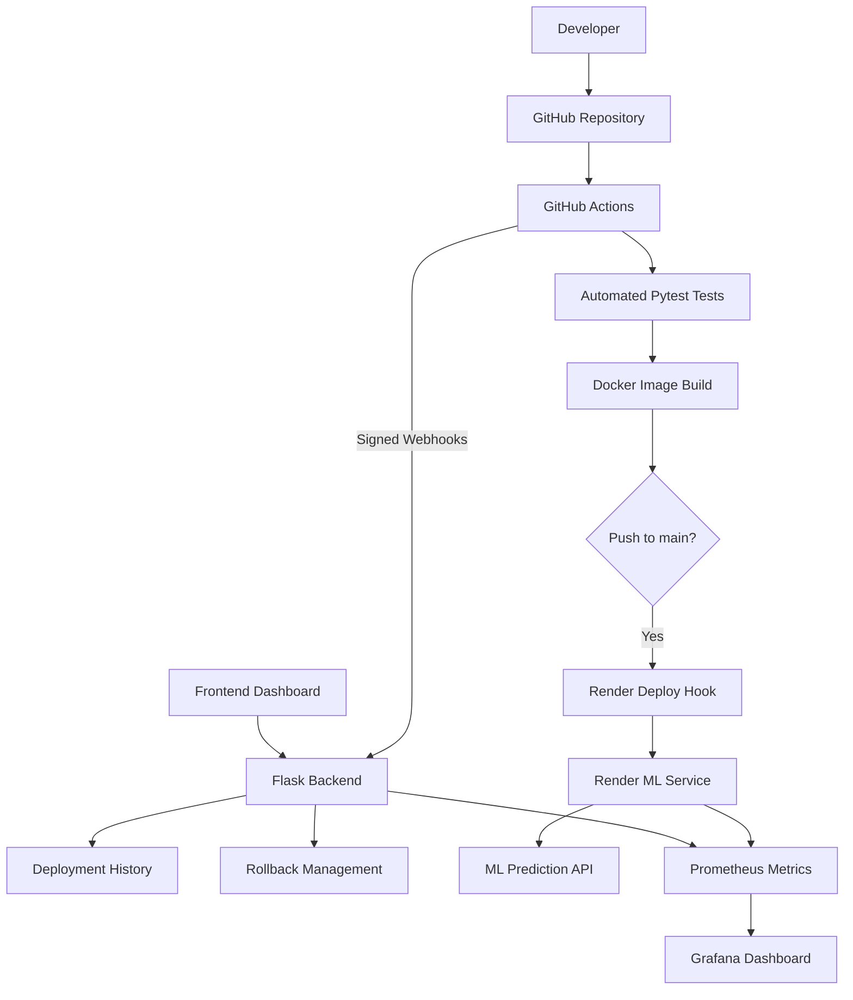

# Model-Setu
### CI/CD Deployment Pipeline for Machine Learning Applications

Model-Setu is a cloud-based deployment management platform designed to automate the testing, containerization, deployment, tracking, and monitoring of machine learning applications.

It combines a Flask-based ML inference service with a deployment management backend, GitHub Actions CI/CD, Docker, Render, Prometheus, and Grafana.

---

## 1. Project Overview

Deploying an ML application involves more than training a model. Developers also need to test application code, package services, deploy updates, monitor API performance, and manage deployment versions.

Model-Setu addresses this workflow by connecting automated CI/CD processes with deployment tracking, API monitoring, and a rollback mechanism.

### Key Objectives

- Automate application testing through GitHub Actions.
- Build Docker images for consistent application packaging.
- Trigger cloud deployments on updates to the main branch.
- Track deployment versions, commits, and execution status.
- Provide APIs for deployment management and rollback.
- Monitor API traffic, latency, and ML prediction activity.

## 2. System Architecture



## 3. End-to-End CI/CD Workflow

1. A developer pushes code to the GitHub repository.
2. GitHub Actions checks out the latest code.
3. Python dependencies are installed.
4. The backend receives a signed webhook to create a deployment tracking record.
5. Pytest executes the automated test suite.
6. Docker Buildx builds the ML service image.
7. For pushes to `main`, GitHub Actions triggers the Render deployment hook.
8. A completion webhook updates the deployment status.
9. The backend maintains deployment history and active deployment information.
10. Prometheus collects application metrics, which Grafana visualizes.

**Note:** The current GitHub Actions workflow builds the Docker image with `push: false`. Render deployment is triggered separately through its deploy hook.

## 4. Technology Stack

| Component | Technology |
|---|---|
| Programming Language | Python |
| Backend API | Flask |
| ML Framework | Scikit-learn |
| ML Algorithm | Random Forest Classifier |
| Dataset | Iris |
| Automated Testing | Pytest |
| Containerization | Docker |
| CI/CD | GitHub Actions |
| Cloud Hosting | Render |
| Version Control | Git and GitHub |
| Metrics Collection | Prometheus |
| Monitoring Dashboard | Grafana |
| Frontend | HTML, CSS, JavaScript |
| Deployment Tracking | Backend database |

## 5. Application Components

### ML Inference Service

The ML service provides a REST API for Iris flower classification.

- Accepts flower measurements as input.
- Returns the predicted Iris class and confidence.
- Exposes health, model information, version, and metrics endpoints.

### Deployment Management Backend

The Flask backend provides:

- Deployment creation and history.
- Deployment status tracking.
- Active deployment information.
- GitHub repository and workflow integration endpoints.
- HMAC-SHA256 signed webhook verification.
- Render deployment rollback initiation and status tracking.
- Prometheus metrics endpoint.

### Frontend Dashboard

The frontend provides an interface for interacting with the backend's deployment management APIs and viewing deployment information.

## 6. API Endpoints

### ML Service

Base URL: `https://model-setu.onrender.com`

| Method | Endpoint | Purpose |
|---|---|---|
| GET | `/` | Service status |
| GET | `/health` | Health check and model status |
| GET | `/version` | Service version |
| GET | `/model-info` | Model information |
| POST | `/predict` | Iris flower prediction |
| GET | `/metrics` | Prometheus metrics |

### Backend Service

Base URL: `https://model-setu-backend.onrender.com`

| Method | Endpoint | Purpose |
|---|---|---|
| GET | `/` | Backend status |
| GET | `/health` | Backend health check |
| GET | `/version` | Backend version |
| GET | `/deployments` | List deployment history |
| POST | `/deployments` | Create deployment record |
| GET | `/deployments/<id>` | Get deployment details |
| GET | `/active-deployment` | Get active deployment |
| PATCH | `/deployments/<id>/status` | Update deployment status |
| POST | `/rollback/<id>` | Initiate Render rollback |
| GET | `/rollback/status/<id>` | Check rollback status |
| GET | `/metrics` | Prometheus metrics |
| POST | `/webhook` | Receive signed CI/CD webhooks |
| GET | `/github/user` | GitHub user integration |
| GET | `/github/repositories` | List GitHub repositories |
| GET | `/github/repositories/<owner>/<repo_name>/branches` | List repository branches |
| POST | `/github/workflows/dispatch` | Trigger GitHub workflow |
| GET | `/github/workflows/runs` | List workflow runs |

## 7. Example ML Prediction

Send a POST request to `/predict`:

```json
{
  "features": [5.1, 3.5, 1.4, 0.2]
}
```

Example response:

```json
{
  "class_id": 0,
  "confidence": 1.0,
  "model_name": "iris-random-forest",
  "model_version": "1.0.0",
  "prediction": "setosa"
}
```

The model information endpoint reports a test accuracy of 0.90 (90%). Prediction confidence and overall model accuracy are different measurements.

### Test the Live ML API

```bash
curl https://model-setu.onrender.com/health

curl https://model-setu.onrender.com/model-info

curl -X POST https://model-setu.onrender.com/predict \
  -H "Content-Type: application/json" \
  -d '{"features":[5.1,3.5,1.4,0.2]}'

curl https://model-setu.onrender.com/metrics
```

## 8. Monitoring with Prometheus and Grafana

Model-Setu includes a local monitoring stack configured with Prometheus and Grafana.

Prometheus is configured to scrape metrics every 5 seconds from:

- Backend service: `host.docker.internal:5001`
- ML service: `host.docker.internal:5002`

### Grafana Dashboard

Dashboard name: **Model-Setu | Deployment & API Monitoring**

The dashboard contains the following panels:

| Panel | What it monitors |
|---|---|
| Total API Requests | Total API request count |
| Requests Per Second (5m) | API request rate |
| HTTP Requests by Endpoint | Traffic across API endpoints |
| Request Latency (Average, seconds) | Average API response latency |
| HTTP Requests by Status Code | HTTP response status distribution |
| ML Prediction Requests | Prediction request volume |
| ML Predictions by Class | Predicted class distribution |
| ML Prediction Errors | Prediction failures |
| Average ML Prediction Latency (seconds) | ML inference latency |

Dashboard configuration is stored in:

`monitoring/grafana/dashboards/model-setu.json`

Prometheus and Grafana provisioning files are stored under:

`monitoring/prometheus/` and `monitoring/grafana/provisioning/`

## 9. Deployment Tracking and Rollback

The backend maintains deployment records containing information such as commit SHA, workflow run ID, version, and deployment status.

The GitHub Actions workflow sends signed start and completion events to the backend. HMAC-SHA256 signatures are used to verify webhook authenticity.

The rollback workflow:

1. Validates the selected deployment.
2. Finds the corresponding Render deployment using its commit SHA.
3. Requests a rollback through the Render API.
4. Tracks the rollback operation status.
5. Updates the active deployment after Render reports the target deployment as live.

**Verification note:** Automated tests cover rollback logic using mocked Render API responses. The production rollback flow has not yet been verified end to end.

## 10. Run the Project Locally

### Prerequisites

- Python 3.9 or later
- Git
- Docker Desktop with Docker Compose
- A code editor such as VS Code

### Step 1: Clone the repository

```bash
git clone https://github.com/Paridhi21shukla/Model-Setu.git
cd Model-Setu
```

### Step 2: Create a virtual environment

```bash
python3 -m venv .venv
source .venv/bin/activate
```

### Step 3: Install dependencies

```bash
pip install -r requirements.txt
```

### Step 4: Start the backend

Open a terminal and run:

```bash
python backend/app.py
```

The backend runs on:

`http://localhost:5001`

### Step 5: Start the local ML service

Open another terminal, activate the virtual environment, and run:

```bash
docker compose up --build -d
```

This starts the ML service, Prometheus, and Grafana.

### Step 6: Access the services

| Service | Local URL |
|---|---|
| Backend API | http://localhost:5001 |
| ML Service | http://localhost:5002 |
| Prometheus | http://localhost:9090 |
| Grafana | http://localhost:3000 |

The default local Grafana credentials configured in Docker Compose are:

- Username: `admin`
- Password: `modelsetu123`

Change the default password before using the setup in a shared or exposed environment.

### Step 7: Run automated tests

```bash
python -m pytest -v
```

## 11. Project Structure

```text
Model-Setu/
├── backend/
│   ├── app.py
│   ├── database.py
│   └── render_service.py
├── ml-service/
│   ├── app.py
│   └── Dockerfile
├── frontend/
│   ├── index.html
│   ├── style.css
│   └── script.js
├── tests/
├── monitoring/
│   ├── prometheus/
│   └── grafana/
│       ├── dashboards/
│       └── provisioning/
├── .github/
│   └── workflows/
│       └── ci.yml
├── docker-compose.yml
├── requirements.txt
└── README.md
```

## 12. Project Status

| Feature | Status |
|---|---|
| ML inference API | Implemented and deployed |
| Docker containerization | Implemented |
| Automated tests | Implemented |
| GitHub Actions CI workflow | Implemented |
| Render deployment trigger | Configured |
| Deployment history and tracking | Implemented |
| Signed webhook verification | Implemented |
| Deployment management APIs | Implemented |
| Render rollback integration | Implemented; production flow not fully verified |
| Prometheus configuration | Configured |
| Grafana dashboard | Configured |
| GitHub workflow integration APIs | Implemented |

## 13. Future Scope

- Verify production rollback through a controlled end-to-end test.
- Extend monitoring with alerting and cloud metrics.
- Add AI-assisted log analysis and anomaly detection.
- Improve deployment analytics and reporting.
- Explore AWS services such as Amazon ECR, EC2, and CloudWatch.
- Enhance dashboard usability and deployment visualization.

## 14. Security

- Never commit `.env` files, passwords, API tokens, or cloud credentials.
- Store secrets in environment variables or an appropriate secret manager.
- Use GitHub Actions Secrets for CI/CD credentials.
- Verify webhook signatures before processing deployment events.
- Change default credentials before exposing local services.

---

**Repository:** https://github.com/Paridhi21shukla/Model-Setu

**ML Service:** https://model-setu.onrender.com

**Backend Service:** https://model-setu-backend.onrender.com
