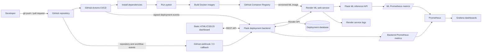

# Model-Setu Architecture

This page documents the architecture represented by the supplied reference diagram, with implementation status made explicit so the repository does not claim features that are not part of the current build.

## Architecture diagram

## Component responsibilities

| Component | Responsibility |
|---|---|
| Developer and GitHub repository | Source control for backend, ML service, frontend, tests, Docker configuration, and monitoring configuration |
| GitHub Actions | Installs dependencies, runs pytest, validates the backend Docker build, builds and publishes the ML-service image, triggers the Render deploy hook, and reports deployment status |
| GitHub Container Registry | Stores versioned ML-service container images |
| Render | Hosts the backend and ML inference services; the ML service runs from the published container image |
| Flask deployment backend | Receives signed CI/CD events, maintains deployment history, integrates with Render, exposes REST endpoints, and exports metrics |
| Deployment database | Persists deployment and rollback-operation records |
| ML inference API | Serves the scikit-learn Iris classification model and exposes health, model-information, prediction, and metrics endpoints |
| Frontend dashboard | Static HTML, CSS, and JavaScript interface that reads backend API data |
| Prometheus | Scrapes application metrics from the backend and ML service |
| Grafana | Visualizes metrics collected by Prometheus |
| Render logs | Provides service and deployment logs through the Render platform |

## Important scope notes

The supplied reference picture is a conceptual diagram, not a literal map of every currently implemented component. The current repository uses a **static HTML/CSS/JavaScript frontend**, not a React dashboard. The current project does **not** include an AI analysis layer, automated anomaly detection, AI-generated insights, or trend-analysis module. Those boxes in the reference picture are not implemented and are intentionally excluded from the current architecture.

Likewise, the current CI/CD workflow publishes the ML-service image to GHCR and validates the backend Docker build; consult `.github/workflows/ci.yml` for the exact workflow steps. The backend exposes the implemented deployment and rollback routes documented in the root README; route names in the supplied conceptual picture may differ.

## Main deployment sequence

1. A developer pushes a change to GitHub.
2. GitHub Actions installs dependencies and runs the automated tests.
3. The workflow validates the backend Docker build and builds the ML-service image.
4. The ML-service image is published to GHCR with a commit-specific tag.
5. The workflow invokes the configured Render deploy hook.
6. The workflow reports deployment lifecycle events to the Flask backend.
7. The backend records deployment state and integrates with the Render API.
8. Prometheus scrapes backend and ML-service metrics; Grafana visualizes the collected data.

## Related files

- Root project overview and setup: [README.md](../README.md)
- CI/CD workflow: [ci.yml](../.github/workflows/ci.yml)
- Docker Compose: [docker-compose.yml](../docker-compose.yml)
- Prometheus configuration: [prometheus.yml](../monitoring/prometheus/prometheus.yml)
- Grafana dashboard definitions: [monitoring/grafana/dashboards](../monitoring/grafana/dashboards)
